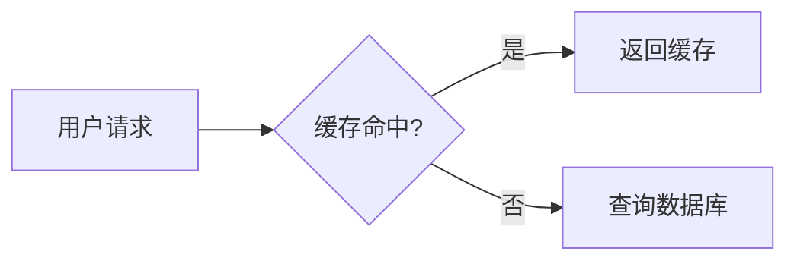

title: README 面子工程
copyright_author: HIOPLE
date: 2026-11-06 23:00:00
cover: /img/githubxmd.png
tags:
  - 技术
categories:
  - tech
---

README 的渲染依据是 **GitHub Flavored Markdown（GFM）**，不是一般的 Markdown。GFM 是 CommonMark 的**严格超集**，表格、任务列表、删除线、裸 URL 自动链接等属于**规范明确收录**的扩展。Alert、数学公式、Mermaid（类图） 等属于 **GitHub 平台原生渲染能力**，不在 GFM 规范文本中，但在 README 中可直接使用。

---

# GitHub Alert

### 五种类型

| 类型标识符 | 中文含义 | 默认颜色 | 图标 | 建议用途 |
|---|---|---|---|---|
| `[!NOTE]` | 备注 | 蓝色 | 信息圆圈 | 用户浏览时应知晓的有用信息 |
| `[!TIP]` | 提示 | 绿色 | 灯泡 | 帮助更轻松完成任务的建议 |
| `[!IMPORTANT]` | 重要 | 紫色 | 验证徽章 | 达成目标所必需的关键信息 |
| `[!WARNING]` | 警告 | 橙色/黄色 | 警告三角 | 因潜在风险需立即关注的内容 |
| `[!CAUTION]` | 小心 | 红色 | 停止八边形 | 操作的潜在负面后果或危险操作 |

用法：

```markdown
> [!NOTE]
> NOTE 内容
```


**① 大小写不敏感**

`> [!note]` 与 `> [!NOTE]` 渲染相同。规范不强制大写，但社区惯例**全大写**，辨识度更高。

**② 可自定义标题**

在 `[!NOTE]` 下一行直接写标题，会覆盖默认的 “Note”：

```markdown
> [!NOTE] 迁移提醒
> 本项目的配置格式将在 v3.0 中变更，请提前阅读迁移指南。
```

**③ Alert 内可包含多个段落**

用空 `>` 行分隔，不会被截断：

```markdown
> [!WARNING]
> 以下操作会永久删除远程分支。
>
> 确认已合并后再执行：
> `git push origin --delete feature/xxx`
```

**④ 可嵌套在列表项中**

用于在步骤说明里插入注意事项。

---

## GFM 规范收录的扩展语法

### 表格

- 不要求列宽对齐，但源码对齐便于维护。
- 分隔行中的 `:` 控制列对齐：

```markdown
| 参数 | 类型 | 默认值 | 说明 |
| :--- | :---: | ---: | :--- |
| `timeout` | `number` | `30` | 请求超时（秒） |
```

- `:---` 左对齐；`:---:` 居中；`---:` 右对齐。

### 任务列表

- 渲染为勾选框；Issue/PR 中可交互，README 中为只读展示。

```markdown
- [x] 完成核心 API 设计
- [x] 编写单元测试
- [ ] 补充端到端测试
- [ ] 发布 v1.0
```

- `- [ ]` 未完成；`- [x]` 已完成（`x` 大小写均可）。
- 方括号内**有空格**是未选中状态。

### 删除线

```markdown
~~这段文字会被划线~~
```

- 三个波浪线 `~~~` 不会触发删除线。

### 裸 URL 自动链接

GFM 会把裸 URL 自动转为链接，不需要 `<url>` 或 `[text](url)`：

```markdown
详见 https://docs.github.com/en/get-started
```

- 这是 CommonMark 不具备、GFM 专门扩展的行为。

---

## GitHub 原生但不在 GFM 规范文本中的 README 能力

> 以下属于 GitHub 平台对 Markdown 文件的**原生后处理/集成能力**，不是 CommonMark / GFM 文本规范本身的一部分。在非 GitHub 渲染器中可能失效。

### 数学公式（MathJax）

- GitHub 原生支持 LaTeX 数学表达式，由 **MathJax** 渲染。
- 行内：`$E = mc^2$`
- 块级：`$$ \int_a^b f(x)\,dx $$`

### Mermaid 图表

- 在 ` ```mermaid ` 围栏代码块中原生渲染流程图、时序图等：

```markdown

```
```

- GFM 规范文本未定义 Mermaid 语法本身，这是 GitHub 渲染管线的扩展。

### 永久链接（Permalink）

- 在 GitHub 文件页面按 **`Y`**，URL 从分支名（如 `main`）切换为**当前提交的 commit ID**，得到指向该文件精确版本的永久链接。
- 引用其他文件时，若希望内容不随分支变动失效，应使用 commit 版本 URL，而非 `blob/main/...`。

---

## GitHub 对 README 内容的官方界定

GitHub Docs 明确 README 应说明：

- 项目做什么
- 为什么有用
- 如何开始使用
- 在哪里获得帮助
- 由谁维护

同时明确边界：

> “A README should only contain information necessary for developers to get started using and contributing to your project. Longer documentation is best suited for wikis.”

即：

- **README 只放“上手所必需”的信息**
- **长篇文档放 Wiki**

---

## 综合模板

```markdown
<div align="center">


# my-project

一个轻量级的配置加载库，支持多格式合并与热重载。

[](https://github.com/user/repo/actions/workflows/ci.yml)
[](https://www.npmjs.com/package/my-project)
[](./LICENSE)

</div>

> [!IMPORTANT]
> v2.0 起最低 Node.js 版本为 18，低于此版本请锁定 `my-project@1.x`。

## 快速开始

```bash
npm install my-project
```

```js
import { load } from 'my-project'
const config = await load('./config')  // 默认合并 yaml / json / toml
```
